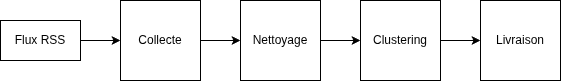
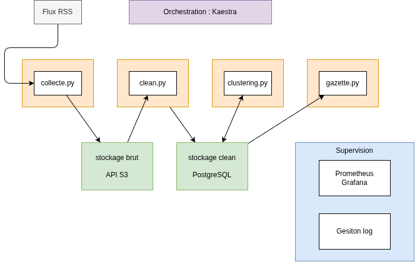
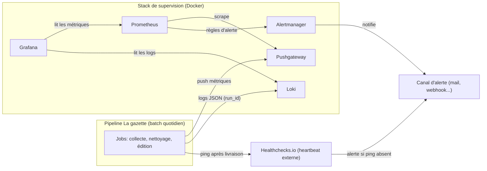

# Cadrage du projet M2Ops

## Le besoin

Automatiser une solution "Gazette" : tous les jours, permet de recevoir la presse régionale et nationale.  
La gazette serait accessible dès 7h du matin, et doit traiter les dernières 24 heures d'actualité.

A minima 8 sources (4 régionales et 4 nationales) doivent être couvertes.

Les articles une fois collectés doivent être regroupés automatiquement selon des thèmes qui émergent des articles du jour.

## Le suivi

Un des point d'attention du projet est sur le suivi de la bonne execution des traitement.  
Un dashboard permettant le suivi des pipelines et la consultation des logs devra être accessible.

## Les briques de la solution

Voici les éléments composants la solution

>

1. La collecte

Nous nous abonnerons à des flux RSS afin de recevoir de manière quotidienne la presse.  
Un script `python` permettra de récupérer les XML issus des flux RSS.

2. Le stockage

Le stockage sera découpé en deux parties :

- stockage brut

Nous partons sur une solution `Api S3` compatible. Cela permet de se lancer en local, et nous permettra de déployer dans le cloud

- stockage données nettoyées

Pour les données traitées nous partons sur un stockage PostgreSQL.  
Nous y stockerons les données nettoyées et les résultats du clustering

3. Le nettoyage

Les données seront nettoyéees via des scripts `python`. Ces données nettoyées seront stockées dans une base de données `PostgreSQL`.

4. Le clustering

Un clustering (non supervisé) sera effectué afin de regrouper les articles par thème. Les thèmes seront ceux du jour (pas de thème prédéfini).  
Les technologies suivantes seront utilisées :

- SBERT pour le calcul des embeddings (vectorisation). Un modèle adapté sera choisit (CamemBERT si toutes les actualités sont en français)
- Clustering agglomératif : pour calculer les clusters
- c-TF-IDF + titre représentatif : pour nommer les clusters

5. Orchestration

Chaque script python tournera à l'intérieur d'un conteneur `Docker`.  
Le pipeline, gérant l'ensemble des tâches sera orchestré avec `Kaestra`, solution plus légère que `Airflow`.

6. La supervision

Schéma global :

La supervision se découpe en deux parties :

- Métriques

Pour la partie métrique, nous choisissons `Prometheus` et `Grafana`.

- Gestion des logs

Pour la gestion des logs nous partons sur `Loki`.  
L'avantage c'est qu'il s'intègre sur notre stockage `S3` et s'intègre avec `Prometheus`